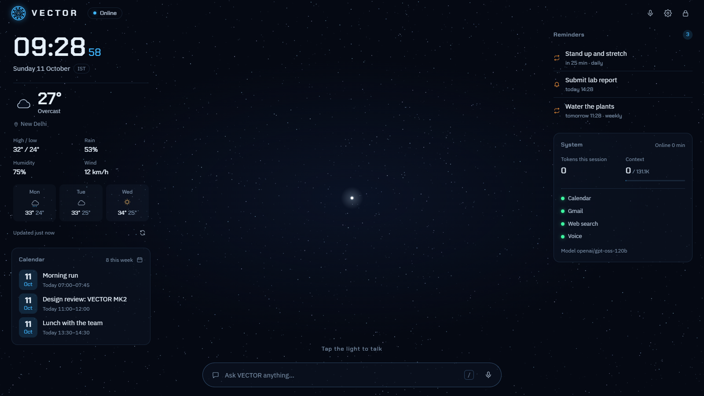
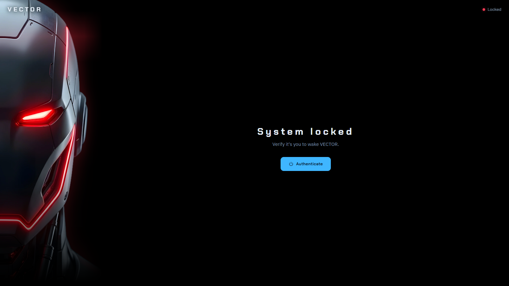
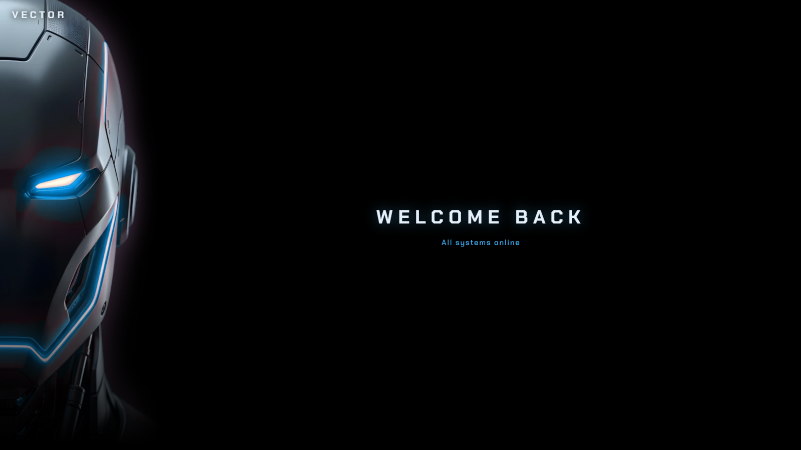
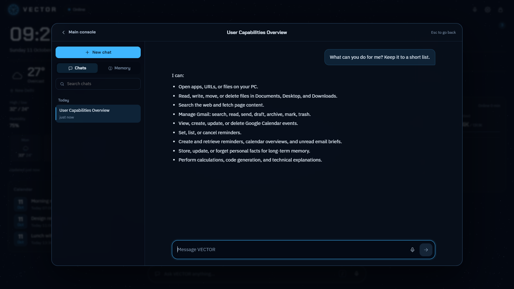
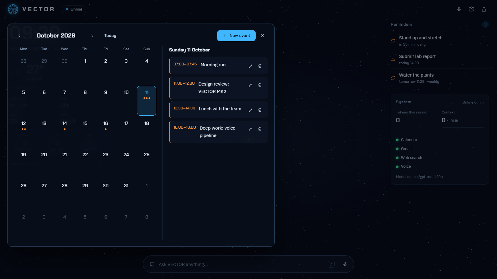
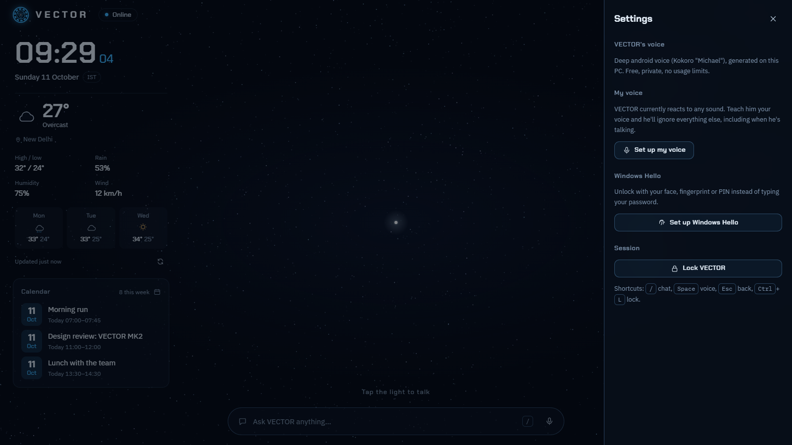

<div align="center">


# VECTOR

**Virtual Engine for Continuous Tasks, Operations & Reasoning**

A personal, voice-first AI assistant for the desktop: it remembers you, acts on your PC, Calendar and Gmail, and answers out loud in its own voice.

`MK2` · React 19 · Vite · TypeScript · Node/Express · Groq · Gemini · Kokoro TTS



</div>

---

## What's new in MK2

MK1 was a chat window with a calendar. MK2 is a full assistant:

- **Persistent memory.** Every conversation is saved, and VECTOR keeps long-term facts about you that it uses in later chats.
- **Tools and automation.** It opens apps, manages files, sets reminders, edits your calendar, triages Gmail and searches the web. It can chain several tools for one request.
- **Its own voice.** A deep android voice generated locally with Kokoro. It's free, private and has no usage limits.
- **Owner-only listening.** A local voiceprint means VECTOR responds to your voice only and ignores the TV, other people and itself.
- **A redesigned console.** It has a living lock screen, a particle "mind" that becomes a voice orb, a chat workspace and auto-refreshing cards.
- **Locked down.** The UI and API need a password or Windows Hello. Sensitive actions wait for your approval.

## Screenshots

| | |
|---|---|
|  |  |
| **Lock screen:** VECTOR boots locked, eyes red. | **Unlock:** the eyes turn blue and VECTOR greets you by voice. |
|  |  |
| **Chat workspace:** streaming replies, titled history, search and a memory tab. | **Calendar:** month view with agenda; create, edit and delete events. |
|  |  |
| **Settings:** voiceprint enrolment, Windows Hello and the keyboard shortcuts. | **Console:** time and weather, calendar, reminders and system status around the core. |

<sub>Screenshots use demo calendar events and reminders.</sub>

## What VECTOR can do

### Conversation and memory
- Streaming chat with conversations titled automatically, history search, and math rendering (KaTeX) and code blocks in replies.
- **Long-term memory:** VECTOR saves durable facts you mention, such as preferences, people, projects and dates, without being asked. You can update them, delete them, or ask it to forget.
- **Recall across chats:** "what did we decide last week about…" makes VECTOR search old conversations.
- Long chats are folded into rolling summaries so the context stays small.
- A redaction filter keeps passwords, API keys and other secrets out of long-term memory.

### Actions (tools)
| Tool | What it does |
|---|---|
| `open` | Opens apps, websites and files on your PC |
| `files` | Lists, reads, writes, moves and deletes files, sandboxed to Documents, Desktop and Downloads (configurable) |
| `reminders` | One-off or repeating reminders (daily, weekdays, weekly). They arrive as Windows toasts, chat messages and spoken alerts |
| `calendar` | Reads, creates, updates and deletes Google Calendar events |
| `email` | Searches, reads, drafts, sends, archives, labels and trashes Gmail |
| `web_search` / `fetch_webpage` | Searches the web with Tavily or Brave and reads pages, naming its sources |
| `briefing` | A summary of today's calendar, reminders, unread mail and weather |
| `remember` / `update_memory` / `forget` / `search_conversations` | Manage memory |

**Safety rails:**
- Sending email, deleting or overwriting files, and deleting events wait for you to approve them on a confirmation card.
- Content from emails, web pages and files is treated as data, never as instructions.

### Morning briefing
Set `VECTOR_BRIEFING_TIME` and VECTOR delivers a spoken-style briefing every morning as a new conversation. If the PC was off at that time, it still delivers when the server starts up to 3 hours later. You can also just say "brief me".

### Voice
- **Speech out:** Kokoro `am_michael` runs locally on the CPU with a deep "android" treatment. The browser's speech synthesis is the only fallback.
- **Speech in:** Groq Whisper (`whisper-large-v3-turbo`).
- **Owner-only gate:**
  - A local TitaNet speaker model (sherpa-onnx) checks every utterance against your enrolled voiceprint.
  - Background voices and VECTOR's own speech are ignored, and only you can interrupt it mid-sentence (barge-in).
  - Enrol once under *Settings → My voice*.

### Models
| Role | Model |
|---|---|
| Main | Groq `openai/gpt-oss-120b` |
| Fallback (on Groq rate limits) | Google Gemini `gemini-3.5-flash-lite` |
| Background chores (titles, summaries) and last resort | Groq `openai/gpt-oss-20b` |

The System card shows tokens used this session and how full the context window is.

### Interface
- **Lock screen:** password or **Windows Hello** (WebAuthn), with brute-force lockout. Every page load starts locked.
- **Console:** a clock, live weather with a 3-day forecast (Open-Meteo), a calendar card that expands into a month view, reminders and a system and connection health card.
- **Voice orb:** click the light (or press `Space`) and particles gather into a sphere that reacts to sound.
- **Live updates:** reminders, briefings and new titles are pushed from the server over Server-Sent Events.
- **Shortcuts:** `/` chat · `Space` voice · `Esc` back · `Ctrl+L` lock.

## Architecture

```
┌──────────── Browser (React + Vite) ─────────────┐
│ Lock screen · Console cards · Voice orb · Chat  │
│ Mic capture (AudioWorklet) → speech gate        │
└───────────────┬─────────────────────────────────┘
                │ REST + SSE  (/api, session cookie)
┌───────────────▼─────────────────────────────────┐
│ VECTOR_CORE (Node + Express, localhost only)    │
│  Model router: Groq → Gemini → Groq utility     │
│  Tool registry + approval queue                 │
│  Memory: SQLite (conversations, facts, summary) │
│  Scheduler: reminders, morning briefing         │
│  Voice: Kokoro TTS · Whisper STT · TitaNet      │
│         (speaker check in a worker process)     │
└───────┬───────────────┬───────────────┬─────────┘
   Google Calendar   Gmail API     Tavily / Brave
```

```
server/            Express API, model calls, memory, scheduler, voice
  tools/           Tool implementations (calendar, email, files, web, …)
src/
  components/      lock/, console/, chat/, cards/, ui/
  engine/          Canvas particle field and orb (no React re-renders)
  hooks/           useChat, useVoice, useLiveEvents
  lib/             Speech gate, mic capture, math text normalisation
  styles/          Design tokens and component styles
```

## Running VECTOR locally

**Requirements:**
- Windows 10 or 11 (toasts, `open` and Windows Hello are Windows features).
- Node.js 22.5 or newer, for the built-in `node:sqlite`.
- A free [Groq](https://console.groq.com) API key.

1. Install dependencies:
   ```bash
   npm install
   ```
2. Copy `.env.example` to `.env` and fill it in:
   - **Required:** `VECTOR_CORE_API_KEY` (Groq) and `VECTOR_LOCK_PASSWORD`.
   - **Optional:** `GEMINI_API_KEY`, `TAVILY_API_KEY`, `VECTOR_BRIEFING_TIME`, `VECTOR_FILE_ROOTS` and more. Each setting is documented in the file.
3. *(Optional, for Calendar and Gmail)*
   - Create a **Desktop app** OAuth client in Google Cloud with the Calendar and Gmail APIs enabled.
   - Save its `client_secret_*.json` file in `server/credentials/`.
   - Connect from the Calendar card.
4. Start the backend. The Kokoro voice (~90 MB) downloads on first start.
   ```bash
   npm run server
   ```
5. Start the UI and open http://localhost:5173:
   ```bash
   npm run dev
   ```

Secrets, OAuth tokens and the memory database (`server/data/`) are git-ignored and stay on your machine.

## Status

VECTOR is a personal project built for a single owner and is still in active development. It isn't production-ready, and its features and architecture will keep changing. Next on the roadmap:
- A multi-provider model router.
- Spoken replies that start while the answer is still being written.
- In-app automation through Windows UI Automation.
- Device-wide context.
- Background task containers.
